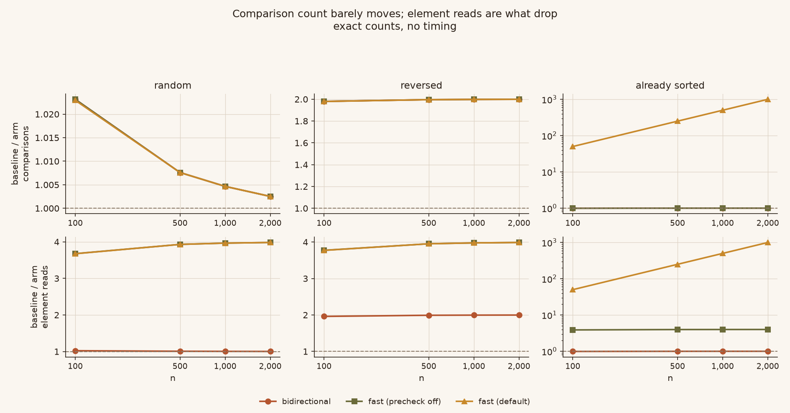
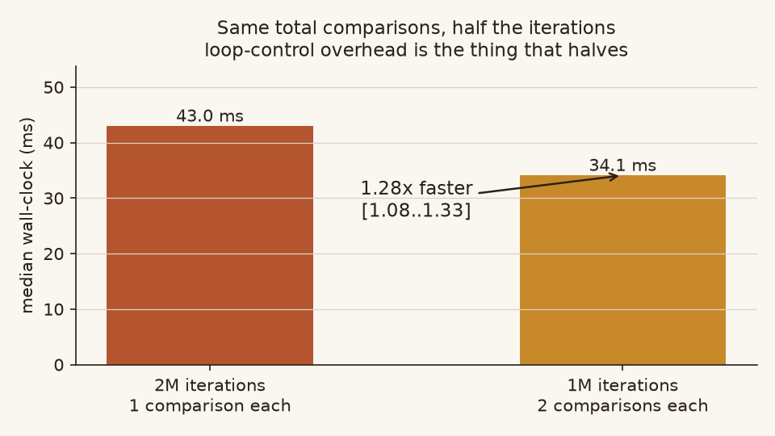
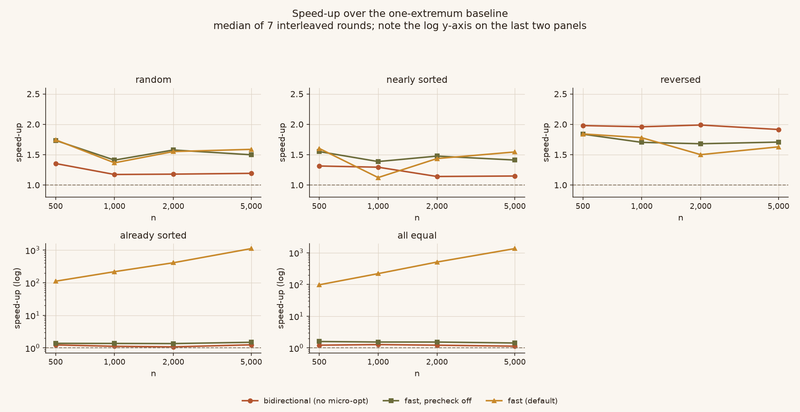
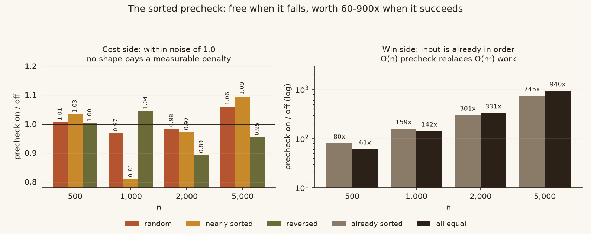

# bidirectional-selection-sort-lab

Three selection-sort arms, and a correction to a popular claim about them.

The widely circulated "double-ended selection sort" write-up says that scanning
for the minimum and maximum in one pass "roughly halves the comparison count".
It does not. Measured, the comparison count is **1.00x** — unchanged. What
halves is the number of loop iterations, and in CPython loop control is the
expensive part, so the optimisation does work; it just works for a different
reason than advertised.

This repo ships the three arms, counts what each one actually does, and measures
the difference under conditions that survive a rerun.

```
                  comparisons   element reads   speed (random)
baseline              1.00x          1.00x           1.00x
bidirectional         1.00x          1.00x           1.2x
fast (cached)         1.00x          4.00x           1.5x
```

## The refutation, in one picture



Top row: comparisons relative to the baseline. On random input the ratio sits
between 1.00 and 1.03 — the double-ended scan pays for its extra extremum almost
exactly. Bottom row: element reads. Caching the extrema cuts them 4x, and *that*
is where the wall-clock gain comes from. Counts are exact; no timing is involved
in this figure.

The only input shape where comparisons really do halve is strictly descending
data, where the second branch never fires. That is a special case, not the
general story.

## Why halving the iterations helps at all



Two loops, identical total comparison count. The one with half the iterations is
**1.28x** faster. In CPython the per-iteration cost (`FOR_ITER`, `STORE_FAST`,
bounds handling) dominates a single `COMPARE_OP`, so trading one loop trip for
one extra comparison is a good trade.

## Speed-up by input shape



Median of 7 interleaved rounds. Note the log y-axis on the last two panels —
those are not small effects.

* **random / nearly sorted**: `fast` reaches 1.4-1.7x. The un-cached
  bidirectional arm only manages 1.2-1.3x, because without caching it reads four
  elements per iteration and the halved iteration count buys nothing.
* **reversed**: ~1.8-2.0x for every double-ended arm. This is the shape where
  comparisons genuinely halve.
* **already sorted / all equal**: 60-900x, entirely from the O(n) precheck
  short-circuiting an O(n²) job.

## The precheck: free when it fails



Left: what the precheck costs on input it cannot help with. All three unsorted
shapes sit between 0.81 and 1.09 with no trend — within noise. An earlier draft
of this repo claimed reversed input got "7-13% slower"; with 7 interleaved
rounds that does not separate from noise, and the claim is withdrawn.

Right: what it buys. The gain grows with n because the scan is O(n) and the work
it skips is O(n²).

## Usage

```python
from bidsel import selection_sort_fast

selection_sort_fast([0, 5, 3, 2, 2])   # [0, 2, 2, 3, 5]
```

Three arms, each differing from the next by exactly one idea:

| function | what it does | why it exists |
|---|---|---|
| `selection_sort` | one extremum per pass | control arm |
| `selection_sort_bidirectional` | min and max per pass, no caching | isolates "double-ended" alone |
| `selection_sort_fast` | double-ended + cached extrema + sorted precheck | the one to use |

`selection_sort_fast` also accepts the precheck being switched off internally
via `bidsel.core.selection_sort_fast_noprecheck`, so you can measure the
precheck yourself instead of trusting this README.

**Requirements:** Python 3.12+ (PEP 695 generic syntax). No dependencies.

**Contract:** only `__lt__` is required. Nothing here uses `<=`, `>=` or a bare
`>`; `a > b` would work through Python's reflected-operand fallback, but relying
on that makes the contract depend on undocumented behaviour.

**Not claimed:** that `fast` is a drop-in replacement for upstream
`selection_sort`. It is not, in the presence of NaN, and all arms are unstable.
See [`docs/CLAIMS.md`](docs/CLAIMS.md#c5-nothing-here-is-a-claimed-drop-in-for-the-upstream-function).

## Counting instead of timing

```python
from bidsel import count_operations, selection_sort, selection_sort_bidirectional

count_operations(selection_sort, [3, 1, 2])
# OpCounts(comparisons=3, subscripts=10, swaps=2)

count_operations(selection_sort_bidirectional, [3, 1, 2])
# OpCounts(comparisons=3, subscripts=10, swaps=2)
```

Counts are exact and machine-independent. When a claim is about *how much work*
something does, this settles it; a stopwatch can only show that two things took
different times and then invites a wrong explanation for why.

## Benchmarking rules this repo follows

Every one of these was earned by getting it wrong first:

1. **Interleave arms within a round, compare per-round ratios.** Running the
   baseline to completion and then the optimised arm reported 1.45x where
   interleaving reported 1.22x — 18.6% inflation from ordering alone.
2. **Copy outside the clock.** A `deepcopy` inside the timed lambda inflated
   n=100 by 21% in the package this repo replaces.
3. **Report a range, not a point.** The original single-run script moved between
   0.93x and 1.45x on n=100 across three invocations.
4. **Never compute a speed-up from absolute milliseconds.** They do not survive
   a process boundary.
5. **Every speed-up names the two adjacent arms that isolate it.**

`benchmarks/run_all.py --ci` runs a 3-second smoke grid and writes
`results-ci.json`, so CI cannot clobber the real `results.json`.

## Layout

```
bidsel/core.py            three arms + count_operations
tests/                    correctness, counts, contract
benchmarks/run_all.py     timing (interleaved rounds)
benchmarks/ops.py         exact operation counts
benchmarks/mechanism.py   the loop-control microbenchmark
assets/make_figures.py    all four figures
docs/CLAIMS.md            every number, and how it was obtained
```

## Running it

```bash
python -m unittest discover -s tests -t . -v    # BIDSEL_FAST=1 for a shorter sweep
python benchmarks/ops.py                        # writes ops.json
python benchmarks/ops.py --check                # verify committed counts, no write
python benchmarks/mechanism.py                  # writes mechanism.json
python benchmarks/mechanism.py --no-write       # run without dirtying the tree
python benchmarks/run_all.py
python assets/make_figures.py                   # needs matplotlib
```

`ops.py --check` is the interesting one: the counts are deterministic, so
recomputing them on a different machine and comparing against the committed
table is a real regression test. Timings are not, which is why
`mechanism.py --no-write` exists and why CI never diffs `results.json` against a
fresh run.

## Credit and licence

The baseline arm follows the shape of
[`sorts/selection_sort.py`](https://github.com/TheAlgorithms/Python/blob/master/sorts/selection_sort.py)
in TheAlgorithms/Python (MIT, 225k+ stars). The double-ended variant is a
textbook algorithm; the contribution here is the measurement, the attribution,
and the two fixes (cached extrema, no self-swaps).

MIT. See [LICENSE](LICENSE).
